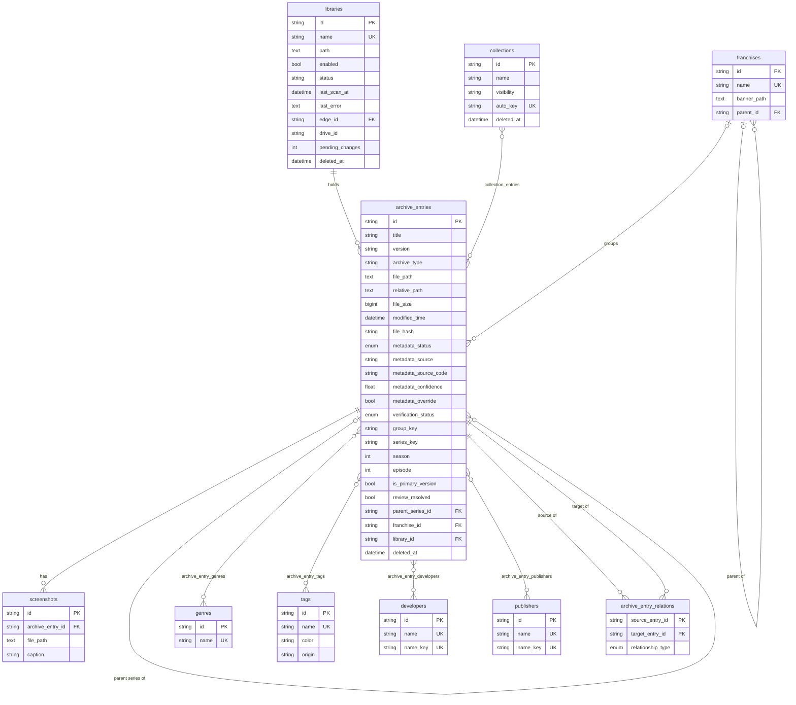
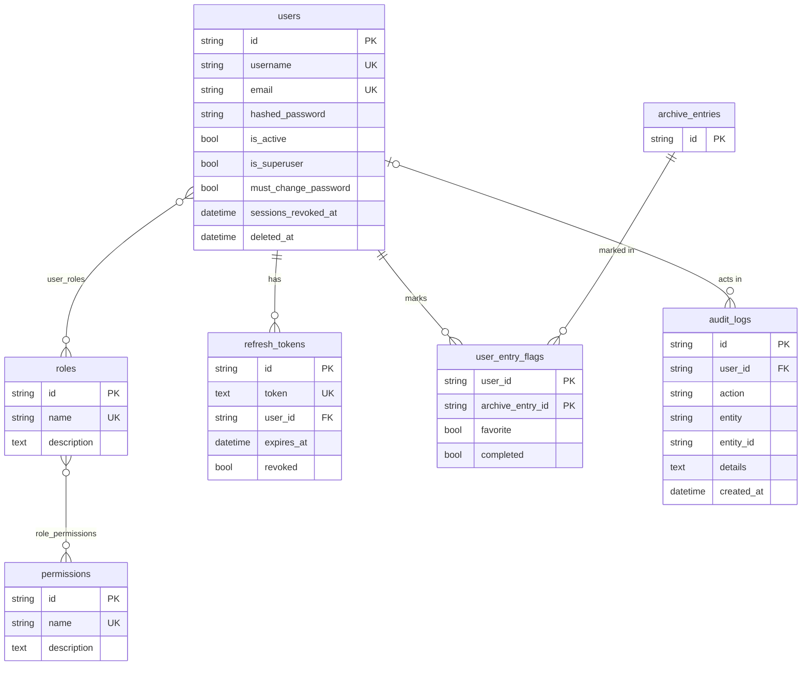
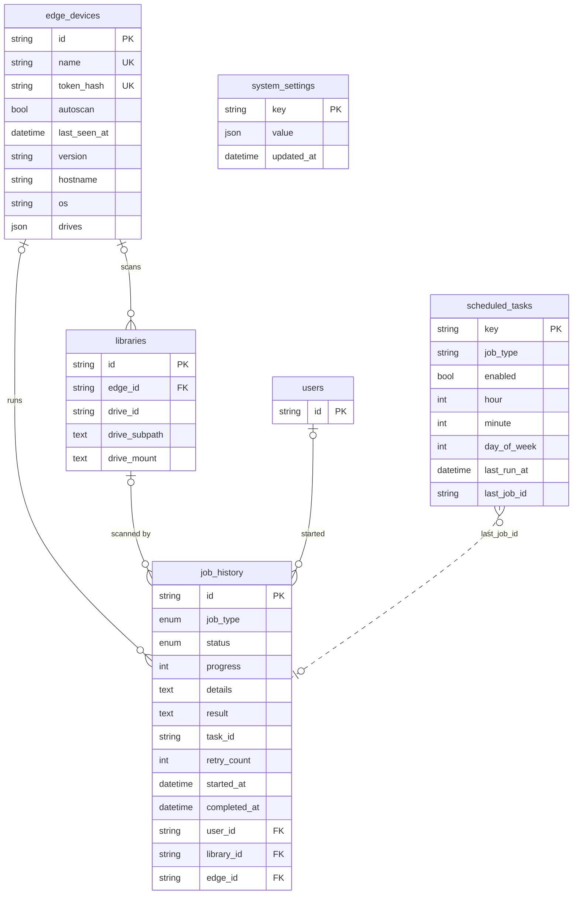

Every table is defined as a SQLAlchemy model in `backend/app/models/`, with the many-to-many tables in `association_tables.py`. Alembic migrations in `backend/alembic/versions/` create and change them. Most primary keys are UUID strings (`String(36)`).

The diagrams below show the key columns, not every column. Timestamps such as `created_at` and `updated_at` are left out unless they matter.

## Catalogue

`archive_entries` also stores `description`, `release_date`, `engine`, `storage_device`, `cover_path`, `banner_path`, `logo_path`, `last_metadata_refresh` and `last_verified`.

## Accounts

## Jobs, edge devices and system settings

`scheduled_tasks.last_job_id` is a plain column, not a foreign key, so the dotted line marks a loose link.

## Tables

| Table | What it holds |
| --- | --- |
| `libraries` | A folder to scan. `edge_id` is empty for a folder on the server, or names the edge device that has it. `status` is `ONLINE` or `OFFLINE`. `drive_id`, `drive_subpath` and `drive_mount` record the drive a library lives on after its first edge scan. `pending_changes` counts new or resized files that an automatic scan found but did not store. A unique index covers the path per machine. |
| `archive_entries` | One file or game folder: a single version of a game. Holds the file facts (`file_path`, `relative_path`, size, modified time, SHA-256 `file_hash`), the metadata match (`metadata_status`, source, record id, confidence), the artwork paths, and the grouping keys (`group_key` for versions of one game, `series_key`, `season` and `episode` for series). |
| `screenshots` | Downloaded or uploaded screenshots of an entry. Deleted with the entry. |
| `genres`, `tags` | Names linked to entries through `archive_entry_genres` and `archive_entry_tags`. `tags.origin` is `provider` for tags imported from metadata, which a refresh replaces, or `user` for tags people added, which are never touched. |
| `developers`, `publishers` | Companies linked through `archive_entry_developers` and `archive_entry_publishers`. `name_key` is a spelling-independent form of the name, so "SEGA" and "Sega" are one record. |
| `franchises` | A franchise, optionally nested under a parent. Entries point at one through `archive_entries.franchise_id`. |
| `franchise_entries` | A franchise-to-entry association table that is still defined but not used; membership is `archive_entries.franchise_id`. |
| `collections` | A named list of entries, linked through `collection_entries`. `auto_key` is set on collections the scanner creates for a series. |
| `archive_entry_relations` | Directed links between entries with a `relationship_type`: `FRANCHISE`, `SEQUEL`, `PREQUEL`, `SPINOFF`, `COLLECTION`, `EPISODE`, `REMASTER` or `RELATED`. The scanner maintains the `EPISODE` links between consecutive episodes. |
| `users` | Accounts. `sessions_revoked_at` rejects access tokens issued before it; `must_change_password` is set on the default administrator. |
| `roles`, `permissions` | Role-based access. Users get roles through `user_roles`, and roles get permissions through `role_permissions`. The built-in roles are Administrator, Moderator, User and ReadOnly. |
| `refresh_tokens` | Refresh tokens, stored as SHA-256 digests, never as the token itself. |
| `user_entry_flags` | One user's favourite and completed marks on one entry. |
| `audit_logs` | Who did what: an action, the entity type and id, and details. |
| `job_history` | Every background job, with its type, status, progress and result. `task_id` is the Celery task id. `edge_id` marks a job that an edge device runs. See [Jobs and workers](/docs/architecture/jobs/). |
| `edge_devices` | Registered edge devices. `token_hash` is the SHA-256 of the device token. `drives` is the list of drives the device reported at its last check-in. |
| `scheduled_tasks` | The five scheduled tasks, with their time, optional weekday and last run. |
| `system_settings` | Key-value server settings stored as JSON, such as the server name, the metadata provider order and source credentials entered in the web app. |

## Enumerations

| Enum | Values |
| --- | --- |
| `metadata_status` | `MATCHED`, `PARTIAL`, `UNMATCHED`, `MANUAL` |
| `verification_status` | `VERIFIED`, `MISSING`, `MOVED`, `CORRUPTED`, `UNKNOWN` |
| `job_type` | `LIBRARY_SCAN`, `INCREMENTAL_SCAN`, `METADATA_REFRESH`, `ARTWORK_REFRESH`, `DUPLICATE_DETECTION`, `INTEGRITY_VERIFICATION` |
| `job_status` | `PENDING`, `RUNNING`, `SUCCESS`, `FAILED`, `CANCELED` |

## Deletes

Entries, libraries, collections and users have a `deleted_at` column. Deleting them through the API sets that column instead of removing the row, so a game a user deleted is not added again by the next scan. Association rows, screenshots and per-user flags are removed with their entry by `ON DELETE CASCADE`.

## Search indexes

Titles, descriptions and the names of collections, franchises, tags, developers and publishers have GIN trigram indexes (`gin_trgm_ops`). They speed up the `ILIKE` substring searches behind the library search.
