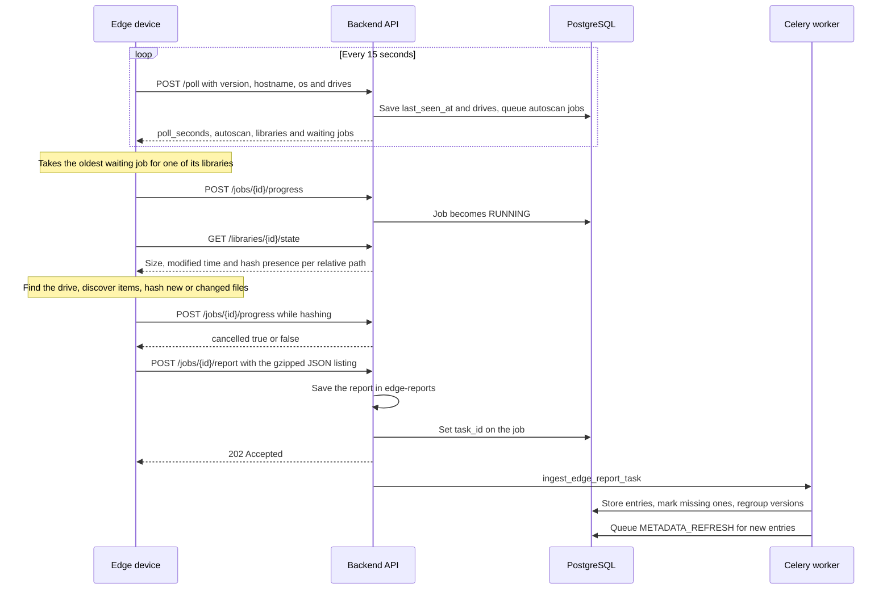

An edge device scans drives attached to another machine and sends what it finds to the server. It keeps no database of its own: every check-in tells it which libraries are its own and which scans are waiting, and the server's worker stores the results as if the files were on the server.

The device runs the backend image with `ludexis edge` (`python -m app.edge`). Its code is in `backend/app/edge/`. The server side is `services/edge.py`, the edge routes in `app/api/` and `core/edge_auth.py`. For installing and running a device, see [Edge devices](/docs/edge/overview/).

## The scan sequence

The device's routes all live under `/api/edge/agent/`, and the paths below are relative to it.

### Poll

The device calls `POST /poll` every 15 seconds with its version, hostname, operating system and the drives it can see. The server stores them on the `edge_devices` row and answers with:

- `poll_seconds`, the interval to use;
- `autoscan`, the device's setting;
- `libraries`, every library assigned to the device;
- `jobs`, the device's `PENDING` and `RUNNING` jobs that have no report yet, oldest first.

A waiting job whose library has since moved to another machine, or was deleted, is cancelled during the poll.

The device runs one job at a time, in a background thread. It keeps polling while it hashes, so the server keeps seeing it. When the server cannot be reached, the device waits 5, 15, 30 and then 60 seconds between attempts.

A device is `PENDING` until its first check-in, `ONLINE` while it checked in within the last 45 seconds (three polls), and `OFFLINE` after that.

### Library state and the scan

Before scanning, the device asks for `GET /libraries/{id}/state`: for every indexed relative path, the stored size, modified time and whether a hash is stored. It then finds the library folder on its drives, discovers items with the same rules as the server's scanner, and decides what to hash.

A scan someone started hashes every file that is new, changed in size or modified time, or has no stored hash. Unchanged files are sent without a hash, and the server keeps the hash it has.

An automatic scan, a job without a `user_id`, only compares sizes. New or resized files are listed by relative path under `pending` and are not hashed or sent as items. The server counts them in `libraries.pending_changes` and treats their entries as still present, so nothing is marked missing in the meantime.

### Report and ingest

The device sends the whole listing as gzipped JSON to `POST /jobs/{id}/report`. The report has the library id, the drive it found the folder on, the items, and the pending paths of an automatic scan. The server:

1. rejects a report for a different library, a second report for the same job (409) and a body over 200 MB (413);
2. saves the body as `edge-reports/<job id>.json.gz` on the data volume, next to the config folder;
3. queues `ingest_edge_report_task` and stores its Celery id in the job's `task_id`.

The worker runs `ScannerService.ingest_report` under the same job. The listing is the whole library, so an indexed path missing from it is gone and its entry becomes `MISSING`. The rest follows the [scan pipeline](/docs/architecture/scan-pipeline/): moves are detected by relative path or hash, new entries are created, versions are regrouped, and a `METADATA_REFRESH` job is queued for new entries. Metadata is always looked up by the server. The report file is deleted once it is stored.

When the device could not reach the folder, it sends a report with an `error` instead, such as "Drive not connected". The library is then marked `OFFLINE` with that reason, and its entries are kept. An empty listing for a library with indexed entries counts as offline too.

### Progress, failure and cancel

Each progress call moves the job to `RUNNING` and updates its percentage, capped at 99 until the worker finishes. When the job was cancelled in the web app, the answer is `cancelled: true` and the device stops. When a scan fails on the device, it calls `POST /jobs/{id}/fail`, and the error shows on the job and in the library's `last_error`.

## Drive identity

A library on an edge device stores its path as that machine shows it, such as `/media/me/Games` or `E:\Games`. After the first scan, the report's drive fields are saved on the library:

| Column | Holds |
| --- | --- |
| `drive_id` | The filesystem UUID on Linux, or the volume serial on Windows |
| `drive_subpath` | The library folder below the drive's root |
| `drive_mount` | Where the drive was mounted at that scan |

From then on the device finds the library by its drive, wherever the drive is mounted next or whichever letter it gets.

- **Linux.** The device lists filesystems mounted below `/media`, `/mnt`, `/run/media` and any folders added in `EDGE_ROOTS`, and reads each one's UUID from udev. A udev rule in the install files hands every new filesystem to a helper that mounts it read-only below `/mnt/ludexis` when a library lives on it.
- **Windows.** Docker Desktop shows no device information, so the `ludexis-edge` command maps each drive letter that holds a library to `/drives/<letter>` and writes the letters' volume serials to `drives.json` in the device's state folder.

Linux shows an NTFS drive's 64-bit serial and Windows its low 32 bits. Drives are compared on the last eight hex digits, so one drive is recognised on both systems.

## Autoscan

With `autoscan` on, which is the default, each poll compares the drives with the ones from the previous check-in. For every newly connected drive, the server queues an `INCREMENTAL_SCAN` for each enabled library on it. It also queues one for an offline library whose drive is not known yet whenever any drive appears.

Autoscan jobs have no user, so they are automatic scans: they hash nothing and only count new or resized files. Only one waiting or running scan per library is kept, however often a scan is asked for while the device is away.

## Token authentication

Each device has its own token:

- The token is `ldx_` followed by 32 random bytes, URL-safe encoded. It is shown once, when the device is added, and written into the `.env` of the install bundle.
- The server stores only its SHA-256 in `edge_devices.token_hash`.
- The device sends it as `Authorization: Bearer ldx_...` on every call. The edge endpoints accept nothing else: no session cookies, no user tokens.
- Rotating the token issues a new one, and the old one stops working at once. Downloading a new bundle needs the device's current token.

Removing a device cancels its waiting jobs. Its libraries and their entries stay and show as offline.

## Versions

The poll reports the device's version. The web app offers an update when the device's major and minor version differ from the server's. See [Updating](/docs/start/updating/).
