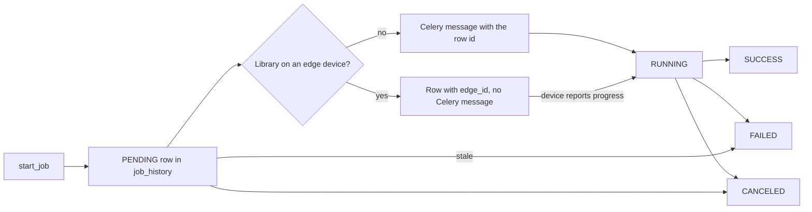

Anything slower than a request runs as a job. Every job is a row in `job_history`, which the web app reads to show progress. Celery carries the work to the worker through Redis, but the row, not Celery, is the record of what happened.

The code is `services/job.py` (`JobService`), `services/scheduler.py` (`SchedulerService`) and the modules in `backend/app/tasks/`.

## Lifecycle

`JobService.start_job` writes a `PENDING` row with the job type, the starting user (empty for scheduled and automatic jobs) and, for scans, the library. It then sends the matching Celery task with the row id and stores the Celery id in `task_id`.

Every job task runs through `run_job` in `tasks/job_runner.py`:

1. It loads the row. A message delivered again for a job that already ended, for example after the worker was killed or the job was cancelled before it started, is ignored, so it cannot revive the job.
2. It sets `RUNNING`, resets `progress` and stores the retry attempt in `retry_count`.
3. It runs the work, which reports progress as a percentage on the row.
4. It ends the row as `SUCCESS` with a summary of the counts in `result`, as `CANCELED` when the work stopped for a cancel, or as `FAILED` with the error.

Job tasks retry on any error with exponential backoff. `JOB_MAX_RETRIES` sets the number of retries and `JOB_RETRY_BACKOFF_MAX` the longest wait in seconds. A retry re-runs the same row.

## Job types and tasks

| `job_type` | Celery task | Work |
| --- | --- | --- |
| `LIBRARY_SCAN` | `scan_full_task` | Full scan of one library or all of them |
| `INCREMENTAL_SCAN` | `scan_incremental_task` | Scan of new and changed files |
| `METADATA_REFRESH` | `refresh_metadata_task` | Match entries never tried and refresh matched ones, then download missing artwork |
| `ARTWORK_REFRESH` | `validate_artwork_task` | Validate, fill or replace artwork, depending on its `mode` |
| `DUPLICATE_DETECTION` | `detect_duplicates_task` | Group entries by file hash |
| `INTEGRITY_VERIFICATION` | `verify_integrity_task` | Hash every file again and compare |

Two more tasks have no job type of their own:

- `ingest_edge_report_task` stores an edge device's report under the device's scan job. See [Edge scans](/docs/architecture/edge-scan/).
- `scheduler_tick_task` is sent by Celery beat and starts scheduled tasks. It writes no job row itself.

A scan that created entries starts a `METADATA_REFRESH` job for them, so new games are matched straight away as a separate, visible job.

## Schedules

Celery beat has a single entry: `scheduler-tick`, which sends `scheduler_tick_task` every five minutes. The schedules themselves live in the `scheduled_tasks` table and are edited in the web app, so changing a time needs no restart.

| Key | Name | Job type | Default time |
| --- | --- | --- | --- |
| `library_scan` | Scan libraries | `INCREMENTAL_SCAN` | Daily at 02:00 |
| `metadata_refresh` | Refresh metadata | `METADATA_REFRESH` | Daily at 03:00 |
| `artwork_validation` | Validate artwork | `ARTWORK_REFRESH` | Daily at 04:00 |
| `integrity_verification` | Verify archive integrity | `INTEGRITY_VERIFICATION` | Sundays at 05:00 |
| `duplicate_detection` | Detect duplicates | `DUPLICATE_DETECTION` | Sundays at 05:30 |

Times follow the server's local time, set by `TZ` in Docker. `day_of_week` runs from 0 for Monday to 6 for Sunday; an empty value means every day.

On each tick, `SchedulerService.tick`:

1. fails stale jobs, as described below;
2. for each enabled task whose last scheduled time has passed since `last_run_at`, starts its job without a user and records `last_run_at` and `last_job_id`;
3. skips a task while a server job of the same type is still `PENDING` or `RUNNING`, and tries again at the next tick.

The rows are created on first use with `last_run_at` set to the current time, so a fresh install does not run every task at once. **Run now** in the web app starts the same job under the user who clicked it, which makes a scan user-started rather than automatic. See [Jobs and schedules](/docs/using/jobs/).

## Cancel

`POST /api/jobs/{job_id}/cancel` works on `PENDING` and `RUNNING` jobs. It revokes the Celery task with `terminate=True` when the job has one, and sets the row to `CANCELED` at once. Scans and metadata refreshes also check the row before each item and stop when it is cancelled. An edge device learns of a cancel from the answer to its next progress call.

## Stale jobs

A job can lose its worker, for example when a container restarts mid-job. Two checks clean these up, so jobs do not show as running for ever or block the scheduler:

| When | Rule | Reason stored |
| --- | --- | --- |
| A worker starts (`worker_ready`) | Every server job still `RUNNING` is failed | Worker stopped while the job was running |
| Every scheduler tick | A server job `RUNNING` for more than 12 hours is failed | Worker stopped while the job was running |
| Every scheduler tick | A server job `PENDING` for more than 24 hours is failed | Job was never picked up by a worker |
| Every scheduler tick | An edge job `PENDING` for more than 7 days is failed | The device did not check in within 7 days |
| Every scheduler tick | An edge job `RUNNING` whose device has not checked in for an hour is failed | The device stopped checking in while it ran the job |

:::note
The worker-start rule assumes one worker. With several workers, a restart of one would fail jobs the others are running.
:::

## Edge jobs

A scan of a library on an edge device is not sent to Celery. `start_job` hands it to `queue_edge_scan`, which writes a `PENDING` row with `edge_id` set and no `task_id`. The device picks it up from its next poll and reports progress itself.

- Only one waiting or running scan per edge library is kept. Asking again returns the existing job.
- A scan of every library also queues one edge job for each enabled edge library.
- Edge rows never count as active for the scheduler, so a device that is switched off does not hold up the server's own jobs.
- A worker restart does not fail edge jobs. They follow the edge rules in the table above instead.
- Once the device sends its report, the row gets a `task_id` for `ingest_edge_report_task` and is treated like any other server job from then on.
- Removing a device cancels its waiting jobs.

## Monitoring workers

The job monitor endpoints ask Celery directly with `inspect()`: which workers answer a ping, and how many tasks each one has active and reserved. Job status and progress always come from `job_history`. See [Monitoring](/docs/using/monitoring/).
