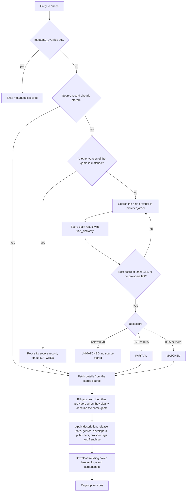
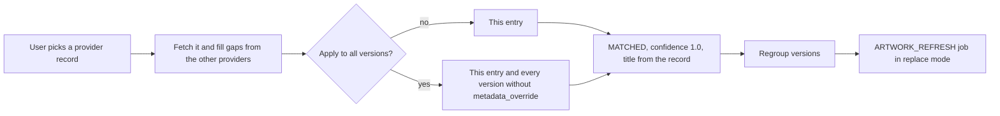
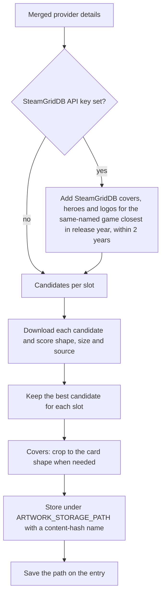

Matching links an archive entry to one record on a metadata source. The record supplies the description, release date, genres, developers, publishers, tags and franchise, and the artwork candidates. The code is in `backend/app/services/`: `metadata.py` (`MetadataService`), `enrichment.py` (`EnrichmentService`), `metadata_conflict.py` and `artwork.py`. The providers are in `backend/app/providers/`.

## Matching an entry

### Provider order

Automatic matching tries the providers in the `provider_order` server setting, one at a time. The default order is VNDB, IGDB, Steam. A provider left out of the order is not used for matching. Administrators change the order in the server settings. See [Metadata](/docs/using/metadata/).

The search stops at the first provider whose best result scores at least 0.85. Otherwise every provider in the order is searched, and the best result across all of them is kept.

A provider that fails or times out counts as having no results, so one source being down never fails a job.

### Title scoring

`title_similarity` compares the entry's title, parsed from the file name, with each result's title:

- When the letters and digits are identical, ignoring spaces and punctuation, the score is 1.0. Archive names often lose their spaces.
- Otherwise the score is the average of the character similarity and the share of whole words in common. A short title such as "Red Moon" then does not match "Bred Moon" on characters alone.

### Confidence thresholds

| Best score | `metadata_status` | Stored |
| --- | --- | --- |
| 0.85 or more | `MATCHED` | The source and record id, and the score in `metadata_confidence` |
| 0.70 to below 0.85 | `PARTIAL` | The same; the entry appears in the review queue |
| Below 0.70 | `UNMATCHED` | Only the score. No source is recorded, so later refreshes never pull details from the wrong game. |

Before searching, matching checks the other versions of the same game. When one of them is already `MATCHED` or `MANUAL`, the entry reuses its record and no search runs.

### Which entries a refresh touches

A `METADATA_REFRESH` job with a list of entries, like the one a scan starts, processes exactly those. The nightly refresh, without a list, processes:

- entries that already have a source record, which are refreshed from it without a new search;
- entries never attempted, which are matched.

Entries that were tried and stayed `UNMATCHED` are left for the review queue instead of being searched again every night. Entries with `metadata_override` set are always skipped.

## Filling gaps from other sources

The matched record is the primary one. Every other provider in the order is then searched with the primary title and the file's title, and its record is merged in only when it clearly describes the same game:

- its title scores at least 0.85 against one of those titles;
- the release years, when both are known, are at most one year apart;
- the two records share at least one developer, when both list developers.

The merge keeps the primary provider's values where it has them and fills the rest:

| Field | Rule |
| --- | --- |
| Title, description, release date | The primary's value, or the other's when the primary has none |
| Genres, tags | The union of both |
| Developers, publishers | The union, matched by a spelling-independent key; the primary's spelling wins |
| Franchise | The primary's, or the other's when the primary has none |
| Covers, banners, logos | The primary's candidates first, then the other's |
| Screenshots | Candidates from both |

A VNDB match can therefore gain IGDB genres and franchises, and Steam screenshots.

### Applying the details

Applying the merged details replaces the entry's genres, developers and publishers, and replaces the tags marked `origin = "provider"`. Tags a user added stay. Developer and publisher names resolve by `name_key`, so "SEGA" and "Sega" link to one record. A franchise is set only when the entry has none, so a franchise a user chose is kept.

## Identify

Identify is the manual override. The user searches one provider, or every provider in the order at once, and picks a record. Searching with a developer name also runs a developer-filtered search and puts that developer's games first.

Identify clears `metadata_override` on the chosen entry, applies the record at once, and regroups, since the new match can join the entry to versions whose file names differ or move it out of its old group. Fresh artwork comes from an `ARTWORK_REFRESH` job in `replace` mode. It downloads every slot again, and clears a slot the new record has no image for, since the old image belonged to the previous match.

Editing an entry's details by hand sets its status to `MANUAL`. With `metadata_override` set, automatic matching and refreshes leave the entry alone.

## Artwork download

After an entry is matched, the enrichment job downloads whatever artwork it is missing: cover, banner, logo and screenshots. The provider details are fetched once and shared by every slot.

- **Covers** prefer portrait images. When no source offers a cover, the banner candidates are used and the best one is cropped to the card.
- **Banners** prefer landscape images. Cover candidates compete too, since wide key art often sits among covers, and a few screenshots are tried when nothing else fits.
- **SteamGridDB** art is added after the sources' own, so official art wins a tie. It matters most when no source has a portrait cover or a wide banner.
- **Storage.** Files are saved below `ARTWORK_STORAGE_PATH` (`/data/artwork` in Docker) under a name that carries a hash of their contents, so browsers can cache them for good. JPEG, PNG and AVIF banners, screenshots and logos are converted to WebP.

The `ARTWORK_REFRESH` job has three modes:

| Mode | Started by | What it does |
| --- | --- | --- |
| `validate` | The nightly scheduled task | Checks every entry's artwork, downloads missing or broken files again for matched entries, and removes stored files nothing refers to |
| `fill` | **Download missing artwork** in the web app | Downloads whatever artwork is missing for every entry |
| `replace` | Identify | Downloads every slot again for the identified entries |

See [Artwork](/docs/using/artwork/) for the user side.

## Extra providers

Further providers can be loaded from a folder set by `PROVIDER_PLUGINS_DIR`. Each `*.py` file there may define `MetadataProvider` subclasses, which are offered alongside the built-in ones and used for matching once they are added to the provider order. See [Metadata providers](/docs/advanced/providers/).
