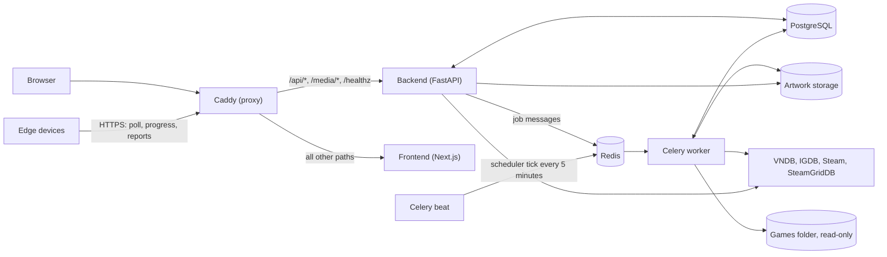

A Ludexis server is a small Docker Compose stack. One address serves everything: a Caddy proxy sends API and artwork requests to the backend and every other request to the web app. Background work runs in Celery processes that share the backend's code, database and data volume.

## Components

| Service | Image or command | What it does |
| --- | --- | --- |
| `proxy` | `caddy:2` | Routes `/api/*`, `/media/*` and `/healthz` to `backend:8000` and everything else to `frontend:3000`. Answers `/api/metrics*` with 404 so metrics stay inside the stack. Gets a certificate when `LUDEXIS_DOMAIN` is set. |
| `frontend` | `ghcr.io/ludexis/ludexis-frontend` | A standalone Next.js server. The pages run in the browser and call the API at `/api`. |
| `backend` | `ludexis server` | Runs `alembic upgrade head`, then serves the FastAPI app with Uvicorn on port 8000. |
| `worker` | `ludexis worker` | A Celery worker that runs scans, metadata refreshes, artwork downloads, integrity checks and edge report ingest. |
| `beat` | `ludexis beat` | Celery beat. Its only entry sends `scheduler_tick_task` every five minutes, which starts the scheduled tasks that are due. |
| `db` | `postgres:16` | The only database. Every job, library and game lives here. |
| `redis` | `redis:7` | The Celery broker and result backend. Job state is not kept here; it is in the `job_history` table. |

The backend, worker and beat containers run the same `ghcr.io/ludexis/ludexis-backend` image. Only the command differs, through the `bin/ludexis` entry point: `server`, `worker`, `beat`, `edge`, or `health <role>` for health checks. Edge devices run that image too, with `ludexis edge`.

The optional `monitoring` profile adds Prometheus, node-exporter and Grafana. See [Monitoring](/docs/using/monitoring/).

## The three repositories

| Repository | Holds |
| --- | --- |
| [Ludexis](https://github.com/Ludexis/Ludexis) | `docker-compose.yml`, `docker-compose.dev.yml`, `deploy/` (Caddyfile, Prometheus config), the documentation and the release notes. It includes the other two as Git submodules. |
| [ludexis-backend](https://github.com/Ludexis/ludexis-backend) | The FastAPI app, scanner, metadata providers, Celery tasks, Alembic migrations and the edge device code. Checked out at `backend/`. |
| [ludexis-frontend](https://github.com/Ludexis/ludexis-frontend) | The Next.js web app. Checked out at `frontend/`. |

The main repository also keeps `docs/architecture/` for the overall design and `docs/knowledge/` for the project's maintained architecture notes, organised by domain and by flow.

## How a request flows

1. The browser loads a page. Caddy passes the request to the Next.js server, which returns the app.
2. The page calls the API, for example `GET /api/archive-entries/`. The browser sends the `ludexis_access` session cookie, and the API client adds the `X-Requested-With` header that the backend requires on cookie-authenticated writes.
3. Caddy forwards `/api/*` to the backend. FastAPI matches a router in `app/api/`, whose dependencies load the user from the token and check the permission the route needs.
4. The route calls a service in `app/services/`, which reads and writes through the repositories in `app/repositories/`.
5. Work that takes longer than a request, such as a scan, becomes a job: the service writes a `job_history` row, sends a Celery message through Redis and returns the row at once. The web app then follows the job's progress. See [Jobs and workers](/docs/architecture/jobs/).
6. Images are requested from `/media/...`. The backend serves them from artwork storage after checking that the user may see the game they belong to.

When the access token has expired, the backend answers 401. The web app calls `/api/auth/refresh` once, which sets new cookies, and repeats the request.

Edge devices go through the same proxy but call their own edge endpoints, with a device token instead of a session. See [Edge scans](/docs/architecture/edge-scan/).

## Where the data lives

| Volume or mount | Mounted at | Contents |
| --- | --- | --- |
| `db_data` | `/var/lib/postgresql/data` in `db` | The PostgreSQL database. |
| `ludexis_data` | `/data` in `backend`, `worker` and `beat` | `artwork/` (covers, banners, logos and screenshots, set by `ARTWORK_STORAGE_PATH`), `config/` (the token signing secret, set by `CONFIG_DIR`) and `edge-reports/` (listings from edge devices waiting to be stored). |
| `GAMES_PATH` | `/games`, read-only, in `backend`, `worker` and `beat` | Your games. Ludexis only reads them. |
| `caddy_data` | `/data` in `proxy` | Certificates for `LUDEXIS_DOMAIN`. |
| `prometheus_data`, `grafana_data` | | Only used with the `monitoring` profile. |

:::tip
Back up `db_data` and `ludexis_data` together. The database stores the paths of the artwork files, and the volume stores the images.
:::
