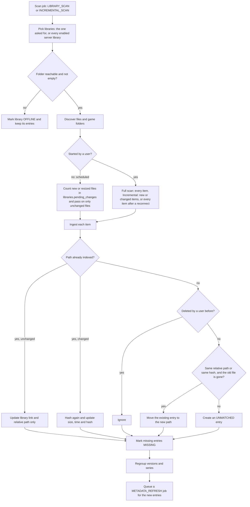

A scan reads a library folder, stores one `archive_entries` row per game file or folder, and hands new entries to metadata matching. The code is `ScannerService` in `backend/app/services/scanner.py`, run by the Celery tasks in `backend/app/tasks/scan_tasks.py`. Grouping lives in `services/grouping.py`.

Edge device libraries follow the same pipeline, except that the device lists and hashes the files and the server stores its report. See [Edge scans](/docs/architecture/edge-scan/).

## Discovery

Discovery walks the library folder and decides, for each child, what it is:

- A file with one of the supported extensions, `.zip`, `.rar`, `.7z`, `.iso` or `.exe`, becomes one item. Its title, version and archive type are parsed from the file name.
- A folder that contains any other file is an unpacked game. The whole folder becomes one item with the archive type `folder`, and its subfolders are part of it. Hidden files, `desktop.ini` and `thumbs.db` do not count.
- A folder that holds only supported archives and subfolders is an organising folder. Discovery goes into it.

Unreadable folders are logged and skipped. Every item gets a `relative_path` below the library root, written with forward slashes, which lets entries follow a library whose root moves.

Discovery runs before any file is stored, so progress is reported against a known total.

## Hashing

Each archive's content is hashed with SHA-256, in 1 MiB chunks, and stored in `file_hash`. Progress moves per chunk, so the bar keeps moving while a large archive is read. Folders are never hashed.

A file is hashed only when it is new or its size or modified time changed. A full scan also hashes indexed files that have no hash yet. An unchanged file keeps the hash it already has.

## Ingest

For each item, ingest picks one of these outcomes:

| Case | Result |
| --- | --- |
| The path is already indexed and its size and time are unchanged | The entry is relinked to the library if needed; nothing is hashed. |
| The path is indexed but the file changed | It is hashed again, and `verification_status` goes back to `UNKNOWN`. |
| A user deleted this game before | It stays deleted. The scan counts it as `ignored_deleted`. |
| The same relative path in the same library, or the same hash, belongs to an entry whose old file is gone | The file was moved, for example to a new drive letter. The existing entry takes the new path and keeps its metadata. |
| None of the above | A new entry is created with `metadata_status` `UNMATCHED`. |

If the old file of a same-hash entry still exists, the new file is a second copy and gets its own entry. Duplicate detection lists such copies later.

One unreadable or vanished file does not stop the scan. Its error is counted and the scan goes on.

## Missing and offline libraries

Before discovery, each library folder is checked:

- A folder that is not found or not readable marks the library `OFFLINE`, with the reason in `last_error`.
- An empty folder while the library has indexed entries also marks it `OFFLINE`. An unplugged drive behind a bind mount looks like an empty folder.

An offline library is skipped, not emptied: its entries stay in the catalogue and show as offline. A library that comes back `ONLINE` is relinked in full on the next incremental scan.

After ingest, every entry of each scanned library is checked against the disk. An entry whose file is gone becomes `MISSING`. An entry that was `MISSING` and is back becomes `UNKNOWN`. The library's `last_scan_at` is updated.

The weekly integrity verification is a separate job. It hashes every file again and sets `VERIFIED`, `MISSING` or `CORRUPTED`, skipping offline libraries and libraries on edge devices.

## User-started and automatic scans

A scan is automatic when its `job_history` row has no `user_id`. Scheduled scans started by the scheduler, and scans an edge device starts when a drive is connected, are automatic. A scan from the web app, including **Run now** on a scheduled task, carries the user who started it.

| | Started by a user | Automatic |
| --- | --- | --- |
| New files | Hashed and stored as new entries | Counted, not read |
| Files whose size changed | Hashed and updated | Counted, not read |
| Unchanged files | Kept and relinked | Kept and relinked |
| `libraries.pending_changes` | Reset to 0 | Set to the number of new or resized files |

Automatic scans hash nothing, so a nightly scan of a large library stays quick. New or resized files wait in `pending_changes` until someone starts a scan from the Libraries page. See [Libraries and scans](/docs/using/libraries/).

For folders, only a new folder counts as pending, since folders have no size to compare.

## Full and incremental scans

Both job types run the same code. A full scan (`LIBRARY_SCAN`) passes every discovered item to ingest. An incremental scan (`INCREMENTAL_SCAN`) passes only new or changed items, except for a library that just came back online, which is passed in full so every entry is relinked. Neither reads an unchanged file that already has a hash.

## Grouping versions

After ingest, `GroupingService.regroup` runs over the whole catalogue:

- **Versions.** Each entry gets a `group_key` from the title parsed out of its file name, so a title edit never splits a group. Entries matched to the same metadata record, or identified as the same name, are joined into one group even when their file names differ. A file-name group whose entries were matched to different games is split by game.
- **Primary version.** In each group, the entry with the highest season, episode, version, modified time and creation time is marked `is_primary_version`. The library shows one card per group.
- **Series.** Entries whose file names carry an episode or part number get a `series_key`. When a series spans at least two version groups, the scanner creates or updates a collection with that `auto_key`, and links the primary version of each episode to the next with an `EPISODE` relation. A series collection a user deleted is not created again.

## Enrichment

When a scan created entries and was not cancelled, it starts a `METADATA_REFRESH` job for exactly those entries, under the same user as the scan. That job matches them against the metadata sources and downloads their artwork. See [Metadata matching](/docs/architecture/metadata/).

## Cancelling

Cancelling a job sets it to `CANCELED` and revokes its Celery task. The scanner also checks the job's status before each item and stops once it was cancelled. Entries stored so far are kept.
